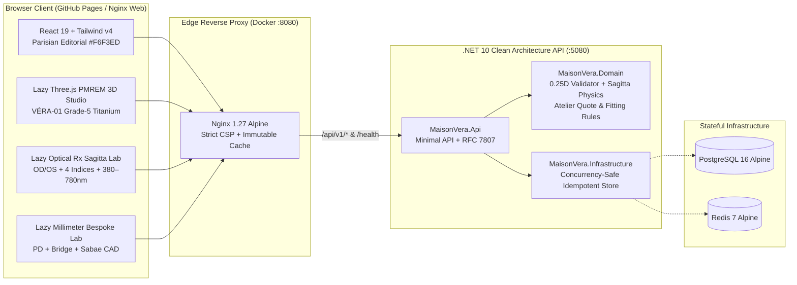

# MAISON VÉRA v5.0 — Full-Stack `.NET 10` Haute Couture 3D Eyewear & Optical Prescription Monorepo

Full-stack luxury architectural eyewear & optical engineering platform combining a **React 19 + Three.js PMREM HDRI 3D Studio**, an **Interactive Optical Rx Sagitta & Spectral Transmittance Lab**, a **Millimeter Bespoke Sizing Lab**, and a **Clean Architecture `.NET 10` Optical Rx & Private Atelier API** with Docker Compose deployment (`Nginx` + `.NET 10` + `PostgreSQL 16` + `Redis 7`).

Designed and engineered by **Truong Van Tinh (`tvt987`)**.

---

## System Architecture



---

## Core v5.0 Full-Stack Capabilities

### 1. Interactive Optical Rx Prescription & Edge Thickness Lab (`prescriptionOpticalEngine.ts` + lazy `OpticalRxLab.tsx`)
- Full clinical optometry inputs for **Right Eye (`OD`)** and **Left Eye (`OS`)**: Sphere (`-10.00` to `+6.00 D` in `0.25 D` steps), Cylinder (`-4.00` to `0.00 D`), Axis (`1°–180°` required whenever `CYL != 0`), Pupillary Distance (`54–74 mm`), and Frame Lens Diameter (`48 / 51 / 54 mm`).
- Computes **exact ophthalmic sagitta** $s = (R - \sqrt{R^2 - h_{\text{eff}}^2}) \cdot k_{\text{asph}}$ with PD decentration across 4 calibrated refractive indices: **`CR-39 1.50`**, **`Poly 1.59`**, **`High-Index 1.67`**, and **`Ultra-Thin 1.74` Japanese Double-Aspheric**.
- Renders a **live side-by-side optical cross-section SVG** comparing `1.50` vs `1.74` against the `4.0 mm` Sabae Grade-5 titanium rim depth (e.g., `-6.00 D` drops from `6.54 mm` to `3.75 mm`, **`-42.7%`** flush fit).
- Plots a **380nm–780nm Spectral Transmittance Curve** comparing UV400 dielectric cutoff (`>= 99.5%` block) and HEV `415–455 nm` Blue-Light studio filtration, with 1-click addition of the recommended lens index upgrade directly to the boutique cart.

### 2. Clean Architecture `.NET 10` Backend (`backend/MaisonVera.sln`)
- `MaisonVera.Domain`: Pure zero-dependency optometry validator, exact sagitta thickness physics engine (1:1 parity with TypeScript), bespoke commission & VietQR 30% deposit quote engine, and fitting reservation domain contracts.
- `MaisonVera.Infrastructure`: Thread-safe atomic slot locking and `Idempotency-Key` deduplication with SHA-256 payload fingerprinting.
- `MaisonVera.Api`: Hardened ASP.NET Core 10 Minimal API exposing:
  - `GET /health`
  - `POST /api/v1/optical/validate-rx`
  - `POST /api/v1/atelier/quote`
  - `POST /api/v1/fittings/reserve` (returns `201 Created`, idempotent `200 OK` replay on duplicate `Idempotency-Key`, and atomic `409 Conflict` under concurrent double-booking)
  - `GET /api/v1/fittings/{reservationId}` & `GET /api/v1/fittings/boutiques/{boutiqueId}`

### 3. PMREM HDRI 3D Studio, Millimeter Bespoke Lab, 16 Hasselblad WebP Photographs & Commerce Engine
- Procedural in-memory **Three.js PMREM HDRI Studio** (`4` animated camera presets including Exploded Assembly, `4` lighting moods, `5` optical lens physics modes with UV 0–11 photochromic darkening) deferred cleanly behind `React.lazy`.
- **Millimeter Bespoke Sizing Lab** generating live Sabae CAD elevations, Fit Score, ranked silhouettes, **VIP Bespoke Lookbook** with printable certificates & JSON spec export, **AI Atelier Stylist (-12%)**, **MBBank VietQR** settlement, and Zod-validated 3-step Checkout.
- Hardened `Content-Security-Policy` + `Referrer-Policy`, zero custom mouse cursors, zero UI emojis, zero `dangerouslySetInnerHTML`/`innerHTML`/`eval`.

---

## Verified Quality & Performance Metrics

| Verification Gate | Result | Highlights |
| :--- | :--- | :--- |
| **Frontend Unit Tests (`npm test`)** | **81 / 81 PASS** (`13` suites) | `59` baseline + `22` new `prescriptionOpticalEngine.test.ts` cases |
| **Backend Integration Tests (`dotnet test`)** | **31 / 31 PASS** (`0` warnings) | `.NET 10.0.401` xUnit + `WebApplicationFactory<Program>` including 16-way concurrent `409 Conflict` race proof |
| **Main Entry Bundle (`npm run build`)** | **`135.76 kB`** (`41.96 kB` gz) | Slashed **`-77.2%`** from `595.25 kB` via `React.lazy` + Rollup `manualChunks` (`three`, `react`, `motion`, `engines`, `icons`) |
| **Playwright Headless E2E** | **PASS (`1440x900` & `390x844`)** | `0` console errors, `0` page errors, `0` failed requests, `0px` horizontal overflow; verified 3D stage, `-6.00 D` sagitta thinning, spectral SVG & cart upgrade |

---

## Architecture & API Documentation

- **OpenAPI 3.1 Specification:** [docs/openapi.yaml](docs/openapi.yaml)
- **ADR-001:** [Optical Sagitta Physics & Clinical 0.25 D Rx Validation Parity](docs/ADR-001-Optical-Sagitta-Rx-Validation.md)
- **ADR-002:** [Procedural PMREM HDRI Lighting & Aggressive Route/Studio Code-Splitting](docs/ADR-002-PMREM-3D-Asset-CodeSplitting.md)

---

## Local Development & Docker Compose

### Full-Stack with Docker Compose (`web` + `api` + `postgres` + `redis`)
```bash
docker compose up --build
# Storefront + API Proxy: http://localhost:8080
# .NET 10 API Direct:     http://localhost:5080/health
```

### Frontend Only (Node 22+)
```bash
npm ci
npm test
npm run build
npm run preview
```

### Backend Only (`.NET 10 SDK`)
```bash
dotnet test backend/MaisonVera.sln
dotnet run --project backend/src/MaisonVera.Api/MaisonVera.Api.csproj
```

---

## CI / CD (GitHub Pages)

Configured via `.github/workflows/ci-and-deploy.yml` (Node 22): executes `npm ci`, `npm test`, `npm run build` (`tsc -b && vite build`), generates SPA `404.html`, and deploys automatically to GitHub Pages.
