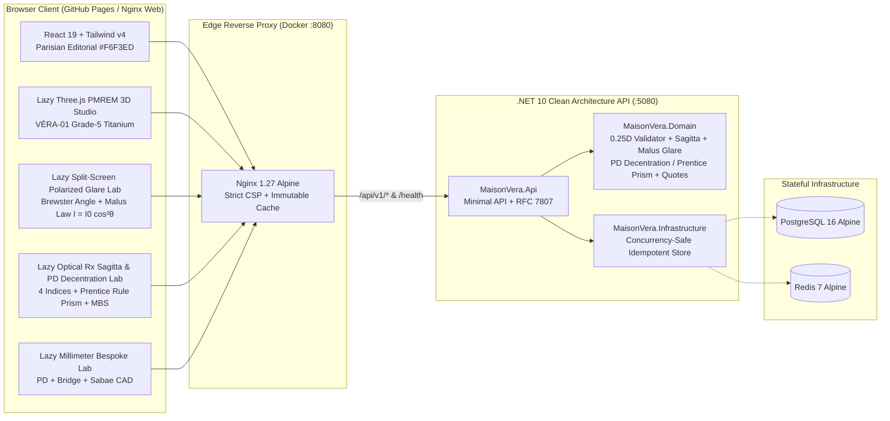

# MAISON VÉRA v6.0 — Full-Stack `.NET 10` Haute Couture 3D Eyewear, Polarized Glare Physics & Optical Decentration Monorepo

Full-stack luxury architectural eyewear & optical engineering platform combining a **React 19 + Three.js PMREM HDRI 3D Studio**, an **Interactive Split-Screen Polarization & Anti-Reflective (AR) Glare Physics Lab**, a **Pupillary-Distance (PD) Optical Decentration & Prentice's Rule Prism Calculator**, an **Optical Rx Sagitta & Spectral Transmittance Lab**, a **Millimeter Bespoke Sizing Lab**, and a **Clean Architecture `.NET 10` Optical & Private Atelier API** with Docker Compose deployment (`Nginx` + `.NET 10` + `PostgreSQL 16` + `Redis 7`).

Designed and engineered by **Truong Van Tinh (`tvt987`)**.

---

## System Architecture



---

## Core v6.0 Full-Stack Capabilities

### 1. Split-Screen Polarization & Anti-Reflective (AR) Glare Physics Lab (`glareOpticsEngine.ts` + lazy `PolarizedGlareLab.tsx`)
- Models real optical physics across **3 lighting environments** using **Brewster's Angle** ($\theta_B = \arctan(n_2/n_1)$) and **Malus's Law** ($I(\theta) = I_{\min} + (I_{\max} - I_{\min})\cos^2\theta$):
  - **Mediterranean Ocean Sun** (Seawater $n = 1.333$, $\theta_B = 53.1^\circ$, $88,000\text{ cd/m}^2$)
  - **Rain-Slicked Night Highway** (Wet Asphalt Film $n = 1.360$, $\theta_B = 53.7^\circ$, $24,000\text{ cd/m}^2$)
  - **High-Altitude Alpine Snow** (Compacted Ice Crust $n = 1.310$, $\theta_B = 52.6^\circ$, $112,000\text{ cd/m}^2$)
- Compares **Uncoated CR-39** (`7.8%` dual-face Fresnel reflection, `12.0%` glare attenuation) vs **Multi-Layer Hydrophobic AR** (`0.4%` surface reflection, `98.8%` crystal VLT) vs **Polarized Optical Filter + Blue-Light AR** (`99.4%` horizontal glare attenuation at $\theta = 90^\circ$, `+16.2 dB` contrast acuity gain, `78%` HEV blue cut).
- Features an interactive **Draggable Champagne-Gold Split-Screen SVG Daylight/Glare Viewport** (`0%–100%` pointer, touch, slider & keyboard support), a live **Malus's Law `0°–90°` Analyzer Curve**, and **1-Click "Apply Optical Coating to Active Frame"** synchronized directly with the VÉRA-01 Hero 3D studio.

### 2. Pupillary-Distance (PD) & Frame Optical Decentration Calculator (`decentrationEngine.ts` integrated into `OpticalRxLab.tsx`)
- Computes exact **Per-Eye Horizontal Optical Decentration** ($\text{Dec} = \frac{(A + \text{DBL}) - \text{PD}}{2}$), horizontal meridian power ($F_h = \text{SPH} + \text{CYL}\sin^2\alpha$), **Prentice's Rule Prismatic Effect** ($\Delta = c \cdot |F_h|$ with Base-In / Base-Out direction vs ANSI Z80.1 $\le 0.67\Delta$ tolerance), and **Minimum Blank Size** ($\text{MBS} = \text{ED} + 2|\text{Dec}| + 2.0\text{ mm}$).
- Evaluates all **4 Maison Véra Sabae Titanium frames** (`46 mm Panto`, `48 mm Archival`, `51 mm Monolith`, `54 mm Aviator`) live against the client's exact PD (`54–74 mm`) and Rx with a live SVG optical centration schematic and ranked fit verdicts.

### 3. Interactive Optical Rx Sagitta & 380–780nm Spectral Transmittance Lab (`prescriptionOpticalEngine.ts` + lazy `OpticalRxLab.tsx`)
- Clinical `0.25 D` OD/OS optometry validation, exact ophthalmic sagitta comparison across **`CR-39 1.50`**, **`Poly 1.59`**, **`High-Index 1.67`**, and **`Ultra-Thin 1.74` Japanese Double-Aspheric** against the `4.0 mm` titanium rim, live `380–780 nm` UV400 + HEV Blue-Light curve, and 1-click cart commissioning.

### 4. Clean Architecture `.NET 10` Backend (`backend/MaisonVera.sln`)
- `MaisonVera.Domain`: Zero-dependency optometry validator, exact sagitta physics engine, Brewster/Malus glare & PD decentration/Prentice's Rule engine (1:1 parity with TypeScript), bespoke commission & VietQR 30% deposit quote engine, and fitting reservation domain contracts.
- `MaisonVera.Infrastructure`: Thread-safe atomic slot locking and `Idempotency-Key` deduplication with SHA-256 payload fingerprinting.
- `MaisonVera.Api`: Hardened ASP.NET Core 10 Minimal API exposing:
  - `GET /health` (`version: 6.0.0`)
  - `POST /api/v1/optical/validate-rx`
  - `POST /api/v1/optical/decentration-glare` (Malus's Law glare attenuation, Brewster angle, VLT, Prentice's Rule prism diopters, MBS blank size & 4-frame Sabae fit verdicts)
  - `POST /api/v1/atelier/quote`
  - `POST /api/v1/fittings/reserve` (`201 Created`, idempotent `200 OK` replay, atomic `409 Conflict`)
  - `GET /api/v1/fittings/{reservationId}` & `GET /api/v1/fittings/boutiques/{boutiqueId}`

### 5. PMREM HDRI 3D Studio, Millimeter Bespoke Lab, 16 Hasselblad WebP Photographs & Commerce Engine
- Procedural in-memory **Three.js PMREM HDRI Studio** deferred cleanly behind `React.lazy`, **Millimeter Bespoke Sizing Lab**, **VIP Bespoke Lookbook** with printable certificates & JSON spec export, **AI Atelier Stylist (-12%)**, real **MBBank VietQR** settlement, Zod-validated 3-step Checkout, strict CSP + `Referrer-Policy`, zero custom mouse cursors, zero UI emojis, and zero `dangerouslySetInnerHTML`/`innerHTML`/`eval`.

---

## Verified v6.0 Quality & Performance Metrics

| Verification Gate | Result | Highlights |
| :--- | :--- | :--- |
| **Frontend Unit Tests (`npm test`)** | **105 / 105 PASS** (`15` suites) | `81` v5.0 + `12` `glareOpticsEngine.test.ts` + `12` `decentrationEngine.test.ts` |
| **Backend Integration Tests (`dotnet test`)** | **48 / 48 PASS** (`0` warnings) | `.NET 10` xUnit + `WebApplicationFactory<Program>` (`31` v5.0 + `17` `DecentrationGlareEndpointTests`) |
| **Main Entry Bundle (`npm run build`)** | **`137.31 kB`** (`42.31 kB` gz) | Strictly `< 145 kB` budget; `three` (`503.60 kB`), `PolarizedGlareLab` (`28.96 kB`), `OpticalRxLab` (`31.88 kB`) all lazy-split |
| **Playwright Headless E2E** | **PASS (`1440x900` & `390x844`)** | `0` console errors, `0` page errors, `0` failed requests, `0px` horizontal overflow; verified `12.0% -> 48.5% (0.4% AR) -> 99.4%` glare physics, Malus `45° = 70.7%`, split-screen handle, PD `58mm`/`73mm` Prentice's Rule & 46mm Panto vs 54mm Aviator verdicts, 3D PMREM stage & Strict CSP |

---

## Architecture & API Documentation

- **OpenAPI 3.1 Specification (v6.0.0):** [docs/openapi.yaml](docs/openapi.yaml)
- **ADR-001:** [Optical Sagitta Physics & Clinical 0.25 D Rx Validation Parity](docs/ADR-001-Optical-Sagitta-Rx-Validation.md)
- **ADR-002:** [Procedural PMREM HDRI Lighting & Aggressive Route/Studio Code-Splitting](docs/ADR-002-PMREM-3D-Asset-CodeSplitting.md)

---

## Local Development & Docker Compose

### Full-Stack with Docker Compose (`web` + `api` + `postgres` + `redis`)
```bash
docker compose up --build
# Storefront + API Proxy: http://localhost:8080
# .NET 10 API Direct:     http://localhost:5080/health
```

### Frontend Only (Node 22+)
```bash
npm ci
npm test
npm run build
npm run preview
```

### Backend Only (`.NET 10 SDK`)
```bash
dotnet test backend/MaisonVera.sln
dotnet run --project backend/src/MaisonVera.Api/MaisonVera.Api.csproj
```

---

## CI / CD (GitHub Pages)

Configured via `.github/workflows/ci-and-deploy.yml` (Node 22): executes `npm ci`, `npm test`, `npm run build` (`tsc -b && vite build`), generates SPA `404.html`, and deploys automatically to GitHub Pages.
